# システム関連図

## 1. システム全体構成図

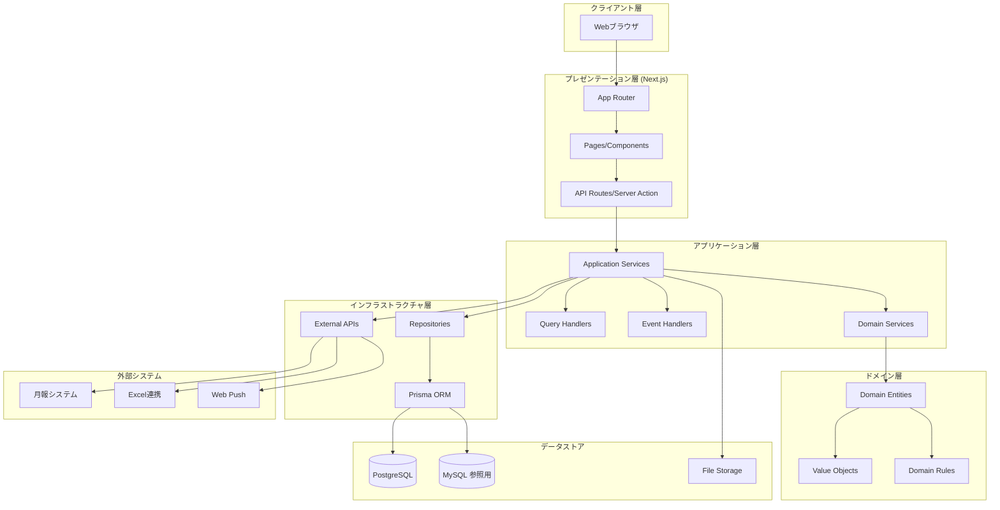

## 2. レイヤー アーキテクチャ（オニオンアーキテクチャ）

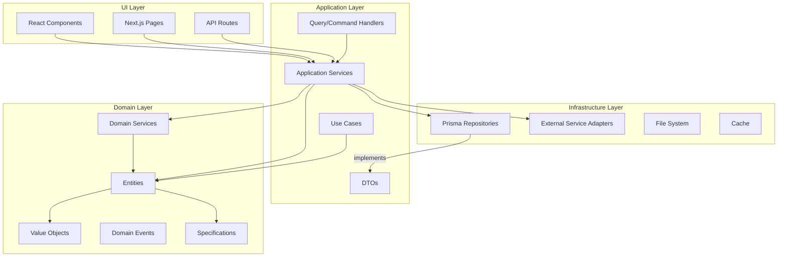

### インターフェイス（Ports）の配置と依存関係

本プロジェクトではオニオンアーキテクチャに従い、「機能を横断できる抽象（インターフェイス/ポート）は内側のレイヤーに置き、具体は外側で実装」する方針です。配置場所と依存関係のルールを明記します。

- 配置ポリシー（原則）
  - アプリケーション層（UseCase/サービスの入口）
    - ユースケースやアプリケーションサービスのインターフェイスを定義
    - 例: `src/applications/*/*-application-service.ts` 内の `I*ApplicationService`
    - 例: クエリ/コマンドハンドラのインターフェイス、バス等のポート
  - ドメイン層（ビジネスルールの中心）
    - リポジトリ、ファクトリ、ドメインサービスなど、ビジネスロジックが必要とするポートを定義
    - 例: `src/domains/*/itask-repository.ts` の `ITaskRepository`
  - インフラ層（外部技術詳細）
    - インターフェイスは持たず、内側で定義されたポートを実装する具体クラスのみを配置
    - 例: `src/infrastructures/*-repository.ts`, `src/infrastructures/**/**.repository.ts`

- 依存関係ルール
  - 依存の向きは常に内向き（UI → Application → Domain）。Infrastructure は Application/Domain のインターフェイスにのみ依存し、逆方向の依存は不可。
  - Application は Domain のエンティティ/値オブジェクト/ドメインサービスおよびドメインのポート（例: Repository インターフェイス）に依存してよい。
  - Domain は UI や Infrastructure に依存しない（フレームワーク非依存）。
  - 依存性注入（DI）は `src/lib/inversify.config.ts` で行い、トークンは `src/types/symbol.ts` に集約。Infrastructure の実装を内側のポート（インターフェイス）にバインドする。

補足（現状と整合性）:

- 現在の実装では、一部のリポジトリインターフェイスが `src/applications/**` 配下に置かれています（例: `src/applications/projects/iproject-repository.ts` の `IProjectRepository`）。これは許容範囲ですが、原則としてはドメインに属するリポジトリポートは `src/domains/**` へ段階的に集約していきます。
- DI の結合点は以下の通りです。
  - トークン: `src/types/symbol.ts`
  - 実装のバインド: `src/lib/inversify.config.ts`

参考図（Ports の位置づけ）:

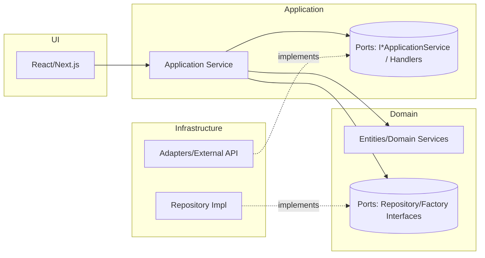

## 3. 主要コンポーネント関連図

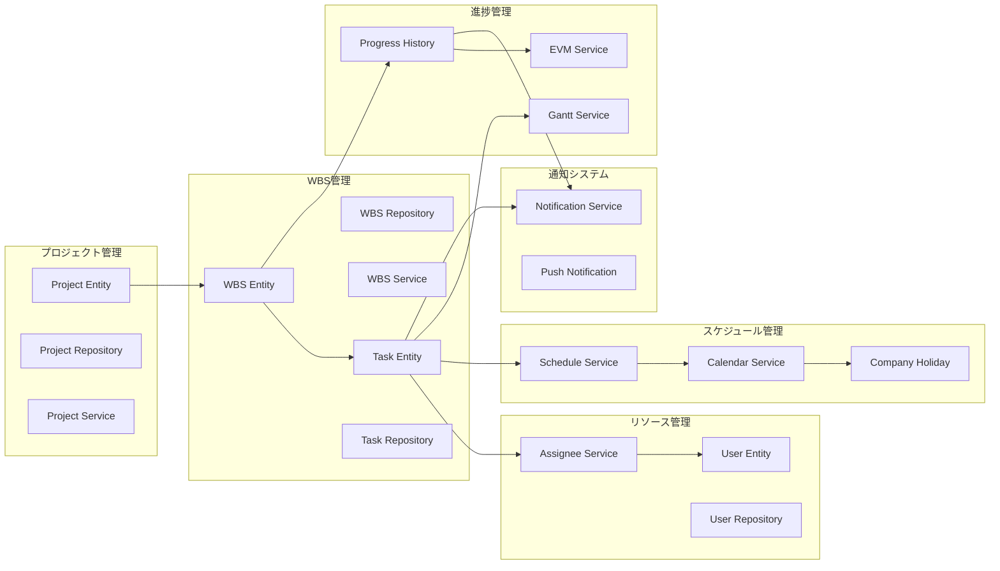

## 4. データフロー図

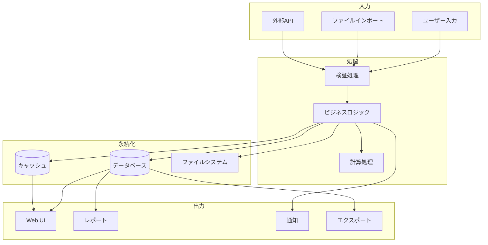

## 5. 認証・認可フロー

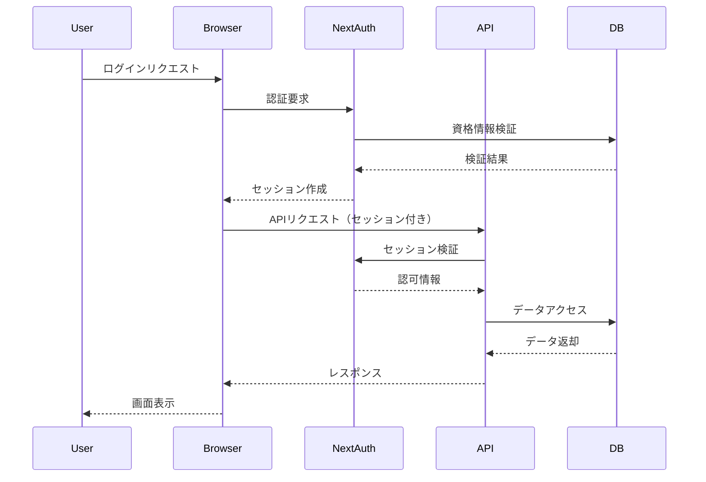

## 6. インポート処理フロー

インポートジョブは呼び出し元（画面・cron・Jenkins・curl）を問わず同じ API / Application Service で作成し、作成順に1件ずつ実行する。
定期インポート（ImportSchedule）はジョブを作成するだけで、インポートジョブ側は定期インポートに依存しない。

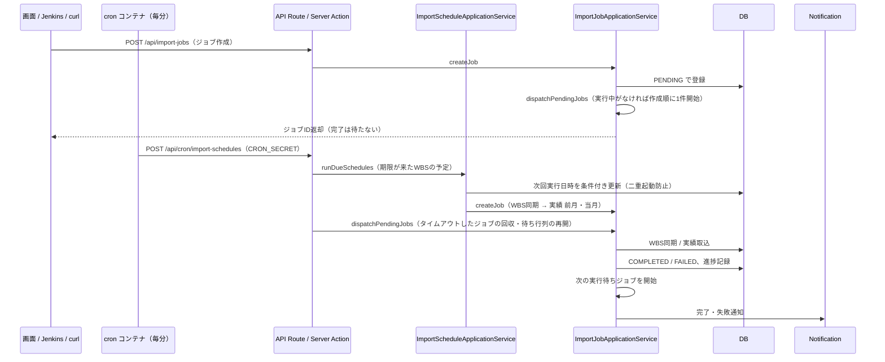

## 7. 依存性注入（DI）構成

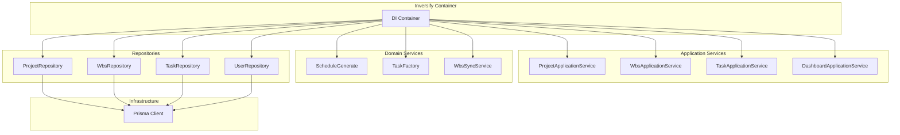

## 8. 主要機能の相関図

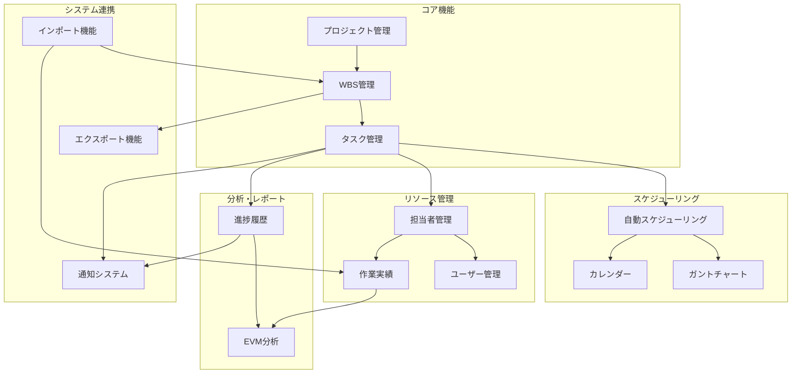

## 9. 技術スタック詳細

### フロントエンド

- **Framework**: Next.js 15 (App Router)
- **Language**: TypeScript
- **UI Library**: React 19
- **Component Library**: Radix UI
- **Styling**: Tailwind CSS
- **Form Management**: React Hook Form + Zod
- **State Management**: TanStack Query
- **Table**: TanStack Table

### バックエンド

- **Runtime**: Node.js
- **API**: Next.js Server Actions / API Routes
- **ORM**: Prisma
- **Database**: PostgreSQL（主系）/ MySQL（Geppo参照用・読み取り専用）
- **DI Container**: Inversify

### インフラストラクチャ

- **Container**: Docker
- **File Storage**: ローカルファイルシステム
- **CI/CD**: GitHub Actions (想定)

### 開発ツール

- **Testing**: Jest, Playwright
- **Linting**: ESLint
- **Build Tool**: Turbopack
- **Package Manager**: npm

## 10. セキュリティアーキテクチャ（想定・整備中）

※以下は目標構成。レート制限・監査ログ等は未実装のものを含む。

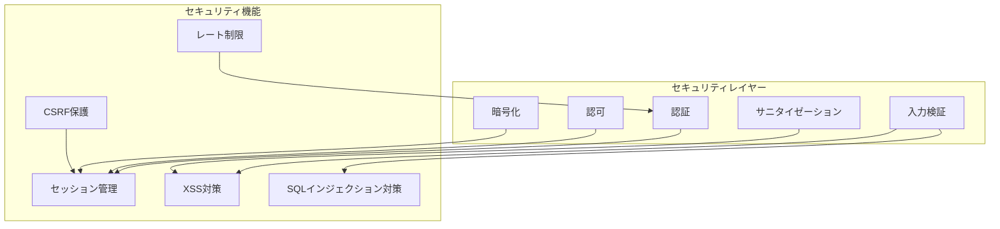

## 11. デプロイメント構成（想定）

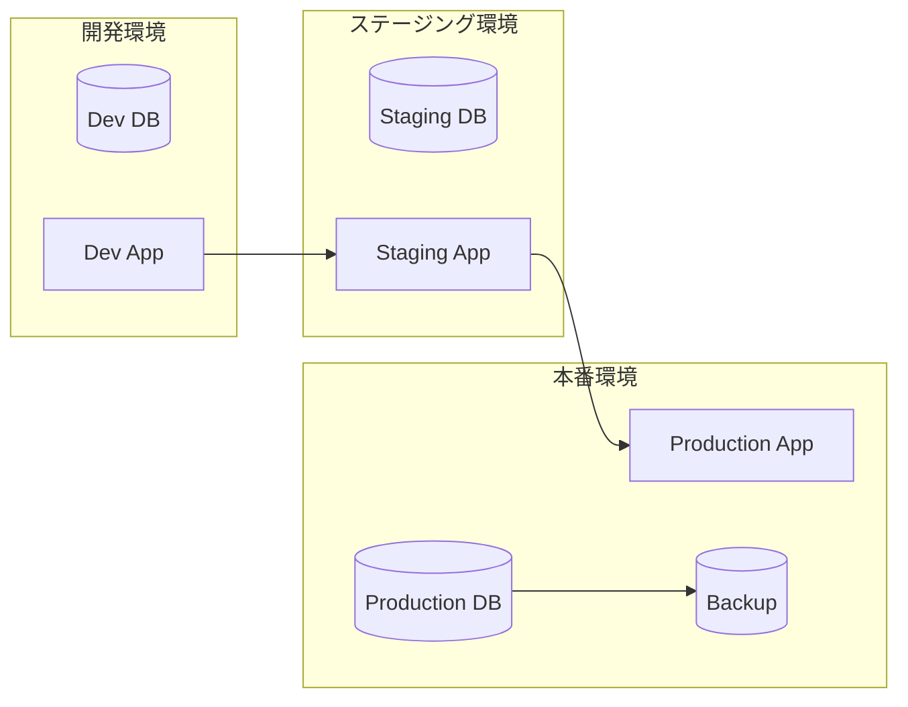

## 12. モニタリング・ログ構成（想定・未実装）

※現状は console ベースの ad hoc なログのみ（docs/08 §6 参照）。以下は目標構成。

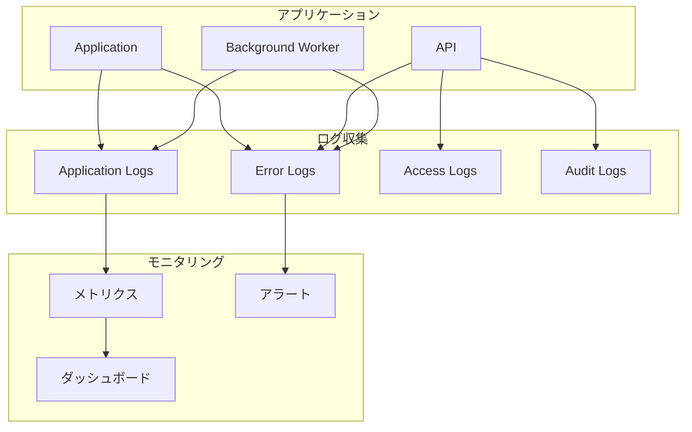
